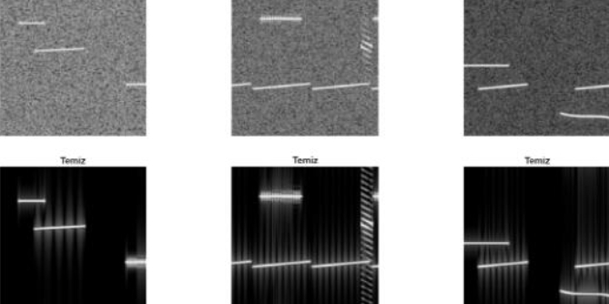

# Research on Radar Signal Denoising and Multi-Label Classification Based on Deep Learning [with Python code]

Research on denoising and multi-label classification of radar signals based on deep learning. In the electromagnetic battlefield, how can multiple radar waveforms be accurately identified and classified when signal noise is overwhelming? This paper proposes an innovative "denoise-classify-extract parameters" three-stage deep learning framework, achieving significant performance improvements under low signal-to-noise ratio (SNR) conditions. In electronic warfare (EW) and electronic support measures (ESM) systems, receivers often need to process multiple radar signals simultaneously in complex electromagnetic environments. However, under low SNR conditions, radar signals are easily masked by noise in both time and frequency domains, making traditional methods based on manual feature extraction difficult to effectively distinguish signal types. This paper introduces a deep learning-based radar signal classification framework, consisting of three core modules: a spectral graph denoising network based on ResNet-18 encoder and U-Net decoder; a multi-label signal classifier based on GoogLeNet; and a radar description word (RDW) parameter extraction pipeline based on edge detection. Experimental results show that the spectral graph denoising network can significantly improve the PSNR from 3.5 dB to 22.6 dB and the SSIM from 0.04 to 0.76 under low SNR conditions. On the classification task, the signals after denoising have significantly better macro average F1 values and subset accuracy than directly using noisy signals. The modular design proposed in this study allows each component to operate independently while also demonstrating good real-time potential.
Keywords: Radar signal classification; Deep learning; Spectral graph denoising; Multi-label classification; Parameter extraction
1. Introduction
1.1 Research background: In the modern electronic warfare environment, the electromagnetic spectrum is increasingly crowded. ESM receivers face two core challenges when detecting enemy radar signals: firstly, in long-range reception or low-power signal conditions, radar pulses are often severely contaminated by background noise in the time-frequency domain, with signal-to-noise ratios (SNR) dropping to -10 dB or even lower, rendering traditional threshold detection algorithms and manual feature extraction methods ineffective; secondly, multiple modulation types of radar signals may overlap within the same time-frequency window, making signal recognition from traditional single-label classification problems into more complex multi-label classification problems.
Time-frequency analysis of radar signals (Time-Frequency Analysis) is a core tool in the field of Signal Intelligence (SIGINT). By converting one-dimensional IQ sampling signals into two-dimensional spectrograms through Short Time Fourier Transform (STFT), the distribution characteristics of signal energy in both time and frequency dimensions can be intuitively displayed. Different types of radar modulation waveforms—including linear frequency modulation (LFM), nonlinear frequency modulation (NLFM), frequency shift keying (FSK), Barker code, Frank code, and P1-P4 multiphase codes—display distinctive textures and geometric structures on the spectrogram. However, these structural differences are easily overwhelmed by Gaussian white noise under low SNR, necessitating an intelligent method that can effectively separate signals from noise.
1.2 Research motivation and contributions: In recent years, deep convolutional neural networks have achieved remarkable success in image denoising and image classification fields. A natural idea is to treat the radar spectrum as a special "image," using deep learning models to learn a nonlinear mapping from noisy spectrum images to clean spectrum images, while also utilizing transfer learning techniques for multi-label signal classification. The key challenge facing this approach is that spectrum images are not natural images, with unique statistical characteristics of pixel distribution and texture structure; the classification task is multi-label rather than single-label, and multiple modulation patterns may coexist in the same spectrum image.
The core contributions of this paper can be summarized in the following four aspects:
1. The first contribution is the design of a multi-frame scene simulator capable of automatically generating paired data with noisy-clean spectrum plots, covering seven types of radar waveforms and four levels of signal-to-noise ratio (20 dB, 10 dB, 0 dB, -10 dB), while also automatically generating multi-label annotation information.
2. The second contribution is the construction of a spectral graph denoising network based on the residual network (ResNet-18) encoder and U-Net style decoder, which retains fine structural information across time-frequency domains through skip connections.
3. The third contribution is the establishment of a multi-label signal classifier based on GoogLeNet, using the Sigmoid activation function instead of the traditional Softmax, introducing weighted binary cross-entropy, soft Jaccard index, and soft subset matching loss functions, and independently optimizing decision thresholds for each category.
4. The fourth contribution is the implementation of an automatic edge detection pipeline from denoised spectral graphs for radar description words (RDW), covering Otsu threshold segmentation, connected component analysis, event merging and clustering, as well as parameter extraction based on pulse repetition interval (PRI), pulse width (PW), bandwidth (BW), and carrier frequency (Fc).
2. Method 2.1 Data set construction The construction of the dataset is the foundation of the entire research. To obtain sufficient quantity and diversity of training samples, this study adopts a full synthetic data generation strategy and designs a multi-frame scene simulator.
Scene simulation process: Each scene is composed of 10 short frames, with a total sampling rate of 30 MHz. Within each scene, from the six signal types {LFM, NLFM, FSK, Barker, Frank, P_All}, one to three types are randomly selected for each signal type, generating parameters such as carrier frequency (Fc), pulse width (PW, 20-200 μs), pulse repetition interval (PRI, 0.2-10 ms), and bandwidth (BW). To prevent spectral overlap interference between different signals, at least 3 MHz of protection band is set between adjacent signals. About 10% of the scenes are set as pure noise scenes (i.e., "none" category) to simulate the situation where signals are absent in real scenarios.
Spectral graph generation: STFT transformation is performed on IQ signals using a 256-point Hamming window with a 75% overlap rate. The calculated dB values are mapped to the [0, 1] range through a fixed global scale, resulting in a long spectral graph of 224×2240 pixels. Subsequently, the long spectral graph is divided into square patches (Patches) of 224×224 pixels with a 50% overlap rate, producing approximately 19 patches. For pure noise patches, they are retained within a proportion of 30% by random sampling to alleviate the issue of class imbalance.
The cross-SNR mixed training strategy is an important design choice in this study. The training set contains data with four SNR levels: 20 dB, 10 dB, 0 dB, and -10 dB, allowing a single model to adapt to a wide range of signal SNR without overfitting to specific noise levels.
Spectral graph denoising method: The denoising network adopts an encoder-decoder structure, balancing feature extraction capability and detail reconstruction accuracy.
Encoder architecture: The encoder is based on the ResNet-18 network pre-trained on the ImageNet dataset, removing its classification head at the end (global average pooling and fully connected layers), retaining only the convolutional feature extraction part. The residual structure of ResNet-18 effectively alleviates the gradient vanishing problem in deep networks, while the pre-training weights on the ImageNet dataset provide a good initialization for spectral graph feature extraction—despite significant differences in visual aspects between natural images and spectral graphs, the edge, texture, and direction information learned by low-level convolutional filters also have transferable value for structures such as Chirp slopes and encoding patterns in spectral graphs.
Decoder architecture: The decoder adopts a U-Net style design, gradually upscaling feature maps back to their original resolution through five stages of transposed convolution layers. Each upscaling stage is followed by a 3×3 convolution layer and ReLU activation function to refine features. Finally, a 1×1 convolution layer compresses the feature maps into a single channel output, combined with a regression layer to calculate the mean squared error loss against clean spectral graphs.
Skip connection mechanism: The essence of the U-Net architecture lies in skip connections—directly stitching shallow feature maps from the encoder onto the corresponding resolution feature maps of the decoder. In the task of spectral graph denoising, shallow feature maps preserve high-frequency structural information such as the chirp line slope and fine boundary of phase coding, which may be progressively compressed and lost in the network's deeper layers. Skip connections ensure that these details are preserved during reconstruction.
Training strategy: Training uses the Adam optimizer with an initial learning rate of 1×10⁻⁴, batch size of 8, and undergoes 40 training rounds. To adapt to pre-trained weights, the learning rate scaling factors for all convolutional layers and transposed convolution layers are set to 0.2. During training, a checkpoint saving mechanism is implemented, supporting interruption recovery and automatic model saving upon best model performance. The validation set accounts for 20% of the training data, and the validation loss is evaluated after each round, updating the best model accordingly.
2.3 Multi-label classification method: The classifier is based on GoogLeNet (Inception v1) and initialized with pre-trained weights from ImageNet.
Multi-label output design: The core constraint of the classification task is that a single spectral graph block may simultaneously contain multiple signal types. The traditional softmax output layer assumes all categories are mutually exclusive and their probabilities sum to 1, which is not suitable for multi-label scenarios. Therefore, this study has modified the output layer to seven independent Sigmoid activation units—each unit independently outputs the probability of the corresponding category being present (between 0 and 1), without any normalization competition between categories. This design allows the model to assign high probabilities to multiple categories simultaneously.
Compound loss function: To adapt to the evaluation characteristics of multi-label classification, the loss function consists of three components:
The first component is weighted binary cross-entropy (Weighted BCE). Addressing the imbalance issue where "none" class samples far outnumber other classes, we calculate weights for each class's positive and negative samples separately—the positive sample weight is inversely proportional to the proportion of positive samples in that class, and the negative sample weight is inversely proportional to the proportion of negative samples—ensuring that minority class samples do not dominate the gradient contribution.
The second component is the soft Jaccard index loss, which is 1 minus the average intersection over union (IoU) across all classes. This loss directly optimizes prediction quality at the subset level, having a strong penalty effect on false positives.
The third component is the soft subset matching loss, calculating the joint probability of all labels being exactly correct for each sample, encouraging the model to achieve "all or nothing" precise predictions.
The weighted combination of these three components enables the model to focus both on the accuracy at the category level and on the completeness at the set level during learning.
Decision Threshold Optimization: For multi-label classification, converting probabilities into binary predictions requires selecting an appropriate threshold. Unlike simply using 0.5 as a unified threshold for all categories, this study independently searches for the optimal threshold (between 0.1 and 0.9 with a step size of 0.025) on the validation set for each category, selecting the one that maximizes F1 values. This strategy is particularly beneficial for categories with few samples, as their Sigmoid output distribution may overall lean towards lower probability intervals.
Training Settings: The Adam optimizer is used, with an initial learning rate of 3×10⁻⁴, linearly warmed up to the initial learning rate in the first 5 epochs, followed by a cosine annealing strategy to decay, batch size of 64, and a total of 60 epochs, with gradient clipping at a threshold of 1.0. Data augmentation techniques (random translation, random occlusion, Gaussian blur) are used to enhance generalization capabilities during training.
To quantify the contribution of denoising to classification performance, two classifiers were trained: one directly on noisy spectral graphs and another on spectral graphs after denoising through a denoising network. Both architectures, hyperparameters, and training strategies were identical, except for the preprocessing stage of the input data.
Parameter Extraction Method: After denoising and classification, the third phase of this framework involves extracting radar descriptive words (RDW) from the denoised spectral graphs, providing structured input for subsequent radiation source identification and pulse deinterlacing.
Binaryization and Post-Processing: First, the denoised spectral graphs are subjected to Otsu's automatic thresholding method to generate binary masks. However, direct Otsu binaryization often results in fragmented foreground regions. Therefore, a series of morphological post-processing operations are introduced: horizontal closing operation to eliminate internal breaks within signals, small area filtering to remove isolated noise points, and gap filling in both time and frequency directions to restore signal continuity disrupted by noise.
Blob detection and merging: Conduct 8-connected component analysis on binary masks to extract geometric properties such as bounding boxes and areas of each connected region (Blob). Considering that the same pulse signal may be fragmented into multiple pieces due to local noise, iteratively merges fragments belonging to the same pulse by evaluating the temporal intervals and pulse width consistency between Blobs. This process reassembles fragments of a single pulse into complete "events."
Event clustering: Each event is assigned attributes such as pulse width, bandwidth, carrier frequency, and local PRI estimation. The clustering process primarily uses PRI and PW as anchor points, BW and Fc as auxiliary features, and adopts a greedy iterative strategy to group events with similar attribute characteristics into the same cluster. The clustering algorithm specifically considers the special characteristics of FSK signals - their carrier frequency may jump between pulses, but the pulse width and PRI remain stable, thus relaxing constraints on the Fc dimension.
RDW generation: Based on the clustering results, each signal cluster is assigned a descriptive word (such as "CHIRP_WIDEBW_PRI_LOCKED," "MULTITONE_FSKLIKE," or "PHASE_CODED_MULTI_BLOB") and a preliminary modulation type label. At the same time, by analyzing the modality distribution of event time intervals to estimate PRI values, all elements of RDW are extracted.
III. Experimental Results and Analysis 3.1 Denoising Performance Analysis The evaluation of denoising performance uses two classical image quality metrics, Peak Signal-to-Noise Ratio (PSNR) and Structural Similarity Index (SSIM), as reference benchmarks.
In quantitative analysis, taking a single spectral block under low SNR conditions as an example, the denoising network significantly improves PSNR from 3.5 dB to 22.6 dB and SSIM from 0.04 to 0.76. This means that after denoising, the spectral block achieves a qualitative leap in both pixel-level fidelity and structural integrity - the network not only eliminates random noise but also successfully restores the clear diagonal lines of linear-frequency signals, the stepped structure of phase-coded signals, and the discrete frequency pattern of FSK signals.
From the performance in different SNR ranges, it is observed that the improvement effect of denoising networks is most significant in the low SNR region (-10 dB to 0 dB), gradually converging in the high SNR region (10 dB to 20 dB) — which aligns with expectations since signal clarity is already good under high SNR conditions. Notably, even at an extremely low SNR of -10 dB, the denoising network can still extract meaningful structural contours from a spectrum graph almost completely obscured by noise.
3.2 Classification Performance Analysis The evaluation of classification performance adopts three levels of multi-label metrics:
**Subset Accuracy** is the strictest metric, requiring all seven labels of a graph block to be correctly predicted for a prediction to be correct. This metric directly measures the model's comprehensive understanding ability for scenarios where multiple signals coexist.
**Macro-F1** first calculates F1 values (the harmonic mean of precision and recall for each category) independently, then takes the average across all categories. This metric is sensitive to categories with few samples, reflecting the model's performance under long-tail distributions.
Category-level F1 shows the difference in classification difficulty between each modulation type under noisy and denoised inputs, helping identify which signal types are most likely to benefit from denoising.
Experimental results show that denoising processing improves classification performance across all SNR levels, with significant improvements especially evident at low SNR conditions. The comparison curves of macro-F1 and subset accuracy indicate that when SNR drops below 0 dB, the classification performance of noisy inputs rapidly declines, while the denoised input classifier maintains relatively robust performance. At high SNR (20 dB), the performance differences between the two become significantly smaller — at this point, the signal itself is sufficiently clear, and the marginal benefits of denoising diminish.
The difficulty gradient of different modulation types can be identified from the analysis of F1 at the category level. Linear Frequency Modulation (LFM) and Nonlinear Frequency Modulation (NLFM) signals have the best classification effect due to their distinct spectral characteristics (clearly visible diagonal patterns). The characteristic of FSK signal is discrete frequency lines, and it also has a good recognition rate after denoising. Phase-encoded signals (Frank and P_All, i.e., P1-P4) due to their relatively complex time-frequency patterns and high similarity among them constitute challenging categories in classification tasks. However, denoising processing has the greatest effect on improving the F1 value of these two types of signals, indicating that fine time-frequency structure is most sensitive to noise and plays a key role in denoising. Buck code signals are of medium difficulty. It is worth noting that the category "none" (pure noise) has a relatively high recognition accuracy, as its spectrum lacks any structural features.
4. Discussion 4.1 Real-time analysis in actual electronic warfare systems, signal processing real-time is a key constraint condition. This study measures the inference delay: denoising processing of a single 224×224 spectral block takes about 50 milliseconds, classification processing takes about 36 milliseconds, and the complete denoising + classification serial chain takes about 86 milliseconds. A complete scene spectrum graph contains about 19 blocks, and the total processing time on CPU is about 1.6 seconds. If the migration to GPU inference is made, the delay is expected to be reduced by 5 to 20 times, and the decision time of a single instance is expected to be compressed to several milliseconds.
Due to the stateless processing model adopted at the block level in this framework, it naturally fits well with Stream Processing architectures. For scenarios requiring higher real-time requirements, further optimization measures can be taken as follows: batch inference to reduce call overhead, reducing the overlap rate between blocks to compress the processing window, adaptive strategies for skipping noise stages under high SNR conditions, model quantization and pruning to reduce computation, and unifying denoising networks and classification networks into an end-to-end integrated inference pipeline.
4.2 Limitations of the Method and Future Directions: This study has several notable limitations worth noting:
Synthetic data generalization boundaries: The current model is entirely trained on synthetic data, and the mathematical models of signals (such as ideal rectangular pulse shapes, additive Gaussian white noise) may deviate from real radar signals. Real signals may be affected by complex factors such as multipath effects, interference, non-Gaussian noise, and transmitter nonlinearities. Future work will require collecting real radar IQ recordings to validate and adapt the model.
Suboptimal nature of model separation training: The current denoising network and classification network adopt an independent training strategy, where the optimization objective of the denoising network (minimizing MSE) does not directly correspond to the optimal preprocessing for the classification task. Joint end-to-end training (backpropagating the classification loss gradients to the denoising network) may further improve classification performance.
Alternatives to edge detection methods: Although the Otsu threshold method in RDW extraction is simple and fast, it may still miss or falsely detect under extremely low SNR conditions. Deep learning-based semantic segmentation methods (such as Mask R-CNN or U-Net segmentation) can be extended as a natural extension, but additional pixel-level labeled data is required.
Scalable signal types: The current framework covers seven signal types, not including more complex intra-pulse modulations (such as frequency hopping, repetition jitter/stagger) and modern LPI waveforms. Future work will need to expand the dataset generator to include a wider variety of waveform types.
Conclusion: This paper proposes a complete "denoising—classification—parameter extraction" three-stage deep learning framework for radar signal classification under low signal-to-noise ratio conditions. The main findings include:
First, the spectral graph denoising network based on ResNet-18 + U-Net can effectively restore signal structure from noisy spectral graphs, improving PSNR from 3.5 dB to 22.6 dB and SSIM from 0.04 to 0.76 at low SNR conditions, laying a solid foundation for subsequent processing.
Second, the GoogLeNet multi-label classifier is combined with Sigmoid activation, weighted BCE+ soft IoU+ soft subset matching composite loss function, and class-level independent threshold optimization to achieve multi-label recognition capabilities for seven radar waveforms.
Third, through comparison of classifier performance under noisy and denoised inputs, quantitative evidence is provided that spectral graph denoising preprocessing significantly improves classification accuracy under low SNR conditions—the marginal benefit of denoising increases monotonically with decreasing SNR.
Fourth, the parameter extraction pipeline consisting of Otsu thresholding, connected component analysis, and mutually exclusive clustering based on PRI/PW can generate structured radar description words from the denoised spectral graph, providing input for radiation source identification in ESM systems.
Fifth, the modular design of this framework allows the denoising, classification, and parameter extraction stages to run independently and be debugged separately, with each module capable of being replaced or upgraded individually, demonstrating its engineering practicality.
This study demonstrates the tremendous potential of deep learning technology in transferring from natural image domains to radar signal processing. As radar reconnaissance technology continues to evolve, intelligent and adaptive signal processing methods will become an indispensable core capability for future electronic warfare systems.
Recommended reading: Interested readers interested in the cross-domain application between radar signal time-frequency analysis and deep learning may further explore cutting-edge technologies such as domain adaptation, self-supervised pretraining, and model lightweighting.

## Images

<!-- PAYMENT_BLOCK -->

## Get this dataset

- Payment link (Stripe): [Buy now](https://buy.stripe.com/3cs8yP7sY87d0vu9AB)
- Payment QR code: 

<!-- /PAYMENT_BLOCK -->
